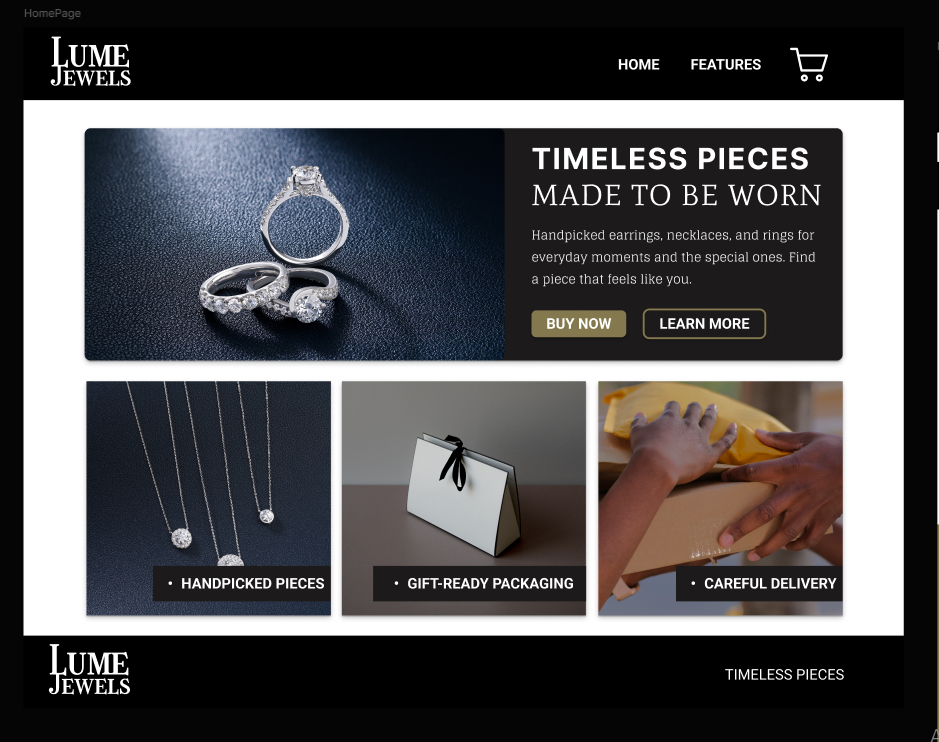
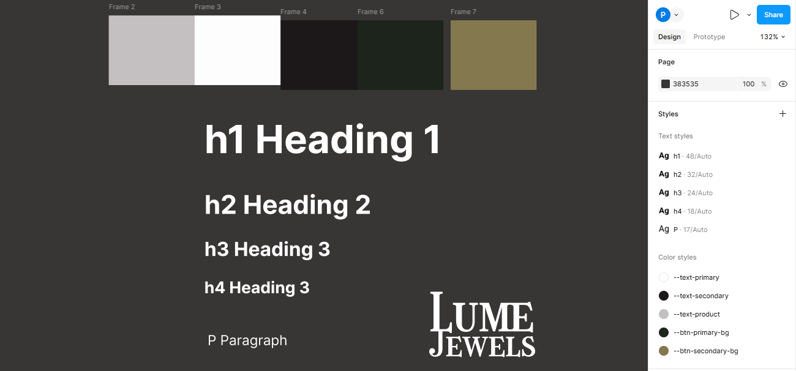
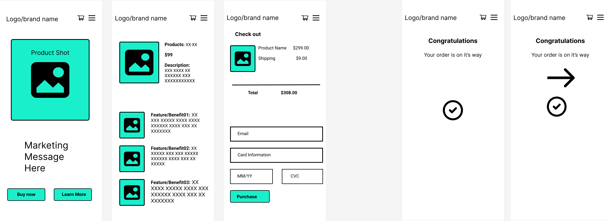
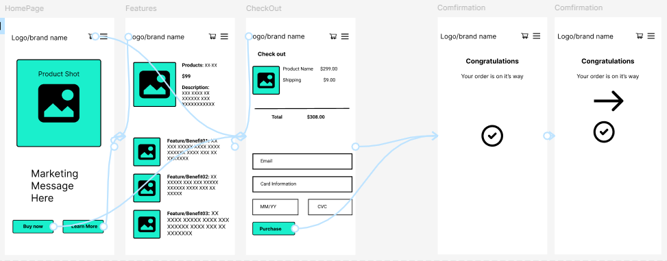
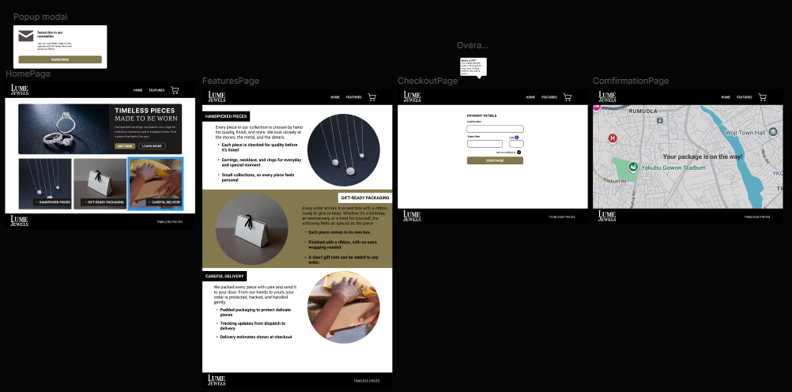
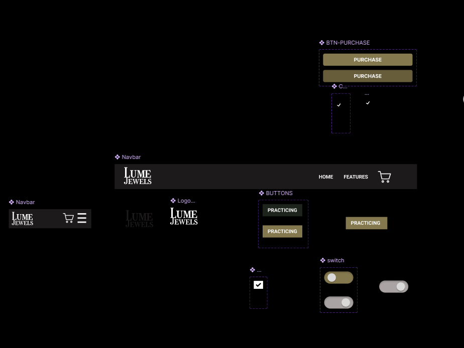
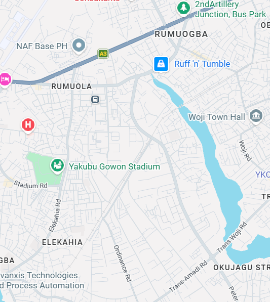

# Lume Jewels

A demo jewelry storefront, designed in Figma and built with React.

Lume Jewels is a practice project. It was my first Figma design project, and I built it in React to understand how a mini online store works from design to deployment. It is not a real shop, and no payments are processed.

## Live demo

https://oeprxc.github.io/lume-jewels/

## About this project

I finished learning React, then learned Figma, and decided to combine both in one project. The goal was to take an idea through the full process: moodboard, style guide, wireframes, prototype, desktop design, then code.
The store has no product page. My mobile wireframe included one, but I chose to keep this project focused on the main shopping flow: Home, Features, Checkout and Confirmation.

## The Figma process



### 1. Style guide and color palette

The style guide defines the colors, text styles and logo used across the whole project.

**Text styles:** h1, h2, h3, h4 and paragraph.
**Color styles:** `--text-primary`, `--text-secondary`, `--text-product`, `--btn-primary-bg`, `--btn-secondary-bg`.
**Palette:** soft grey, white, near black, deep green and an olive gold accent.


### 2. Mobile wireframe and prototype

I started with a mobile wireframe covering the home page, features, checkout and confirmation, and linked the screens in a Figma prototype to test the flow.



### 3. Desktop design

The final desktop design covers the home page, the features page, checkout and the confirmation page with a map.


### 4. Components

I built reusable Figma components to practice: the desktop and mobile navbars, the logo, primary and secondary buttons, the purchase button, a checkbox and a switch.


## Pages and features

**Home:** hero banner with "Buy now" and "Learn more" buttons, plus three featured cards.

**Features:** three sections covering handpicked pieces, gift-ready packaging and careful delivery.

**Checkout:** payment form with card number, expiry date and CVV, and a CVV tooltip I added on my own. Fields are validated, and the form shows an error when something is missing or wrong.

**Confirmation:** full-screen map with the message "Your package is on the way!"

**Responsive navbar:** on small screens it becomes a menu that slides down, with an overlay behind it. The icon switches between menu and close, and the menu closes when a link is clicked.

## Built with

- React
- Vite
- React Router (`HashRouter` for GitHub Pages)
- lucide-react for icons
- CSS Custom Properties (Variables) & Media Queries
- Figma for design

## Run it locally

You need [Node.js](https://nodejs.org) installed.

```bash
# 1. Clone the repository
git clone https://github.com/oeprxc/lume-jewels.git

# 2. Go into the project folder
cd lume-jewels

# 3. Install dependencies
npm install

# 4. Start the development server
npm run dev
```

Then open the local link shown in your terminal (usually http://localhost:5173/lume-jewels/).

## Testing the checkout

This is a practice project, so **please do not enter a real card.** Use the practice card number shown on the checkout page.

## What I learned

- Taking a project from idea to design to code
- Routing with React Router
- State with useState, used for the mobile menu
- Form handling and validation
- Responsive design with media queries
- Deploying to GitHub Pages, and fixing routing and base path issues

## Credits

Images

- Handpicked pieces card image by glorious-studio on Pexels

- Gift-ready packaging card image by Kindel Media on Pexels

- Careful delivery card image by Alleksana on Pexels

- Map
  

Designed and built by **Precious Emmanuel**
